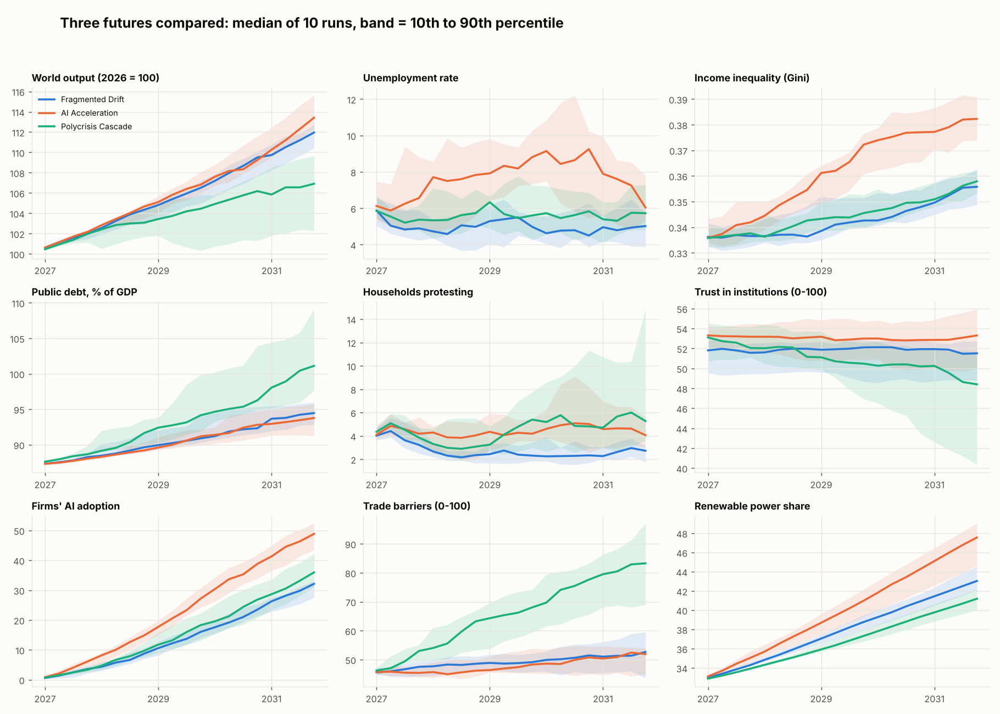
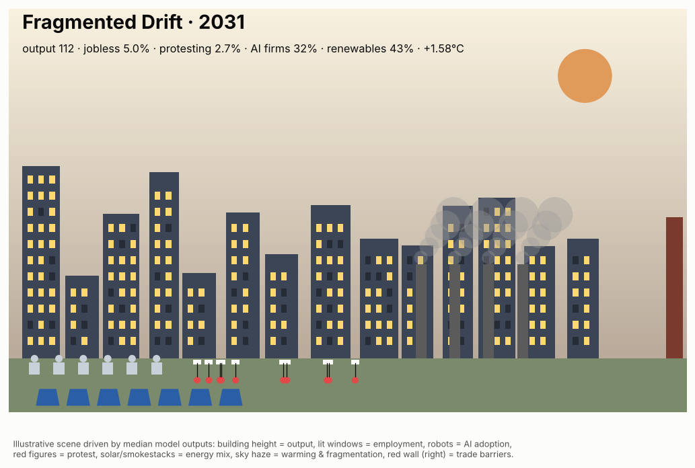
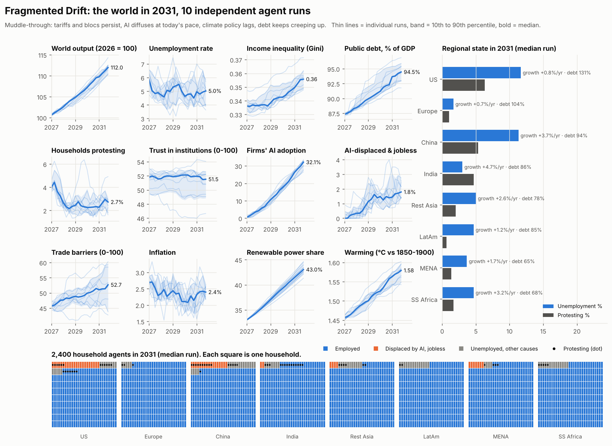
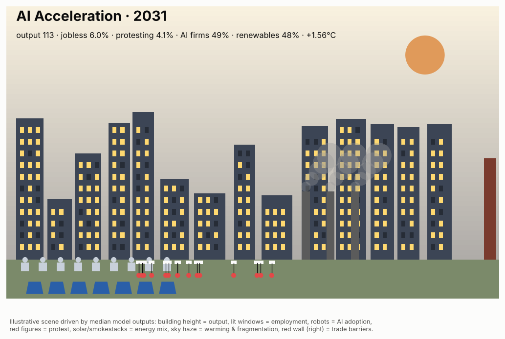
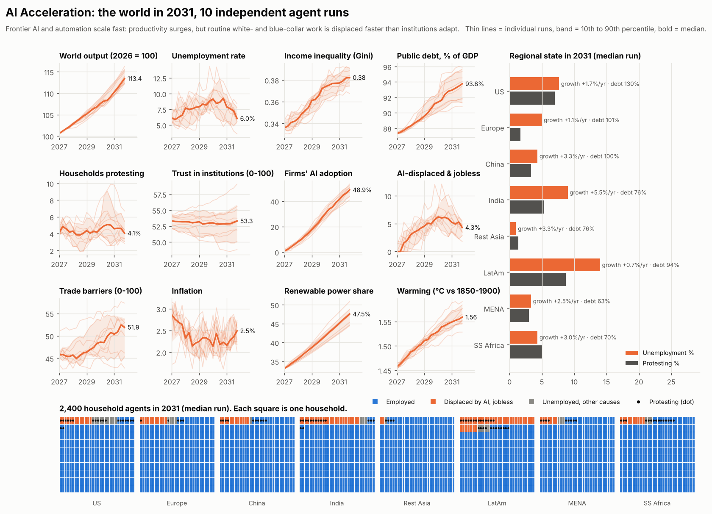
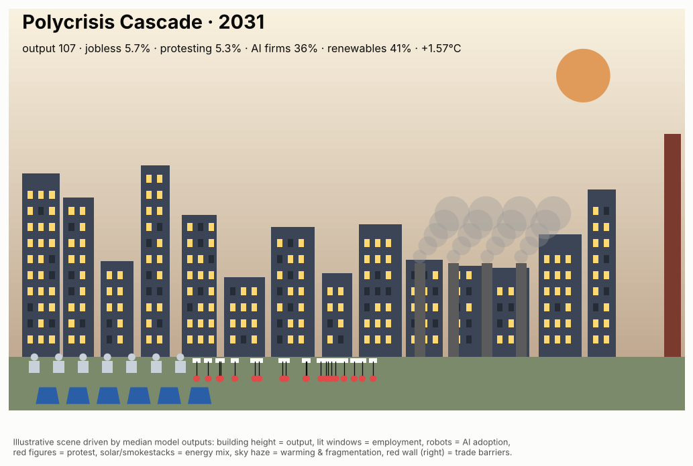
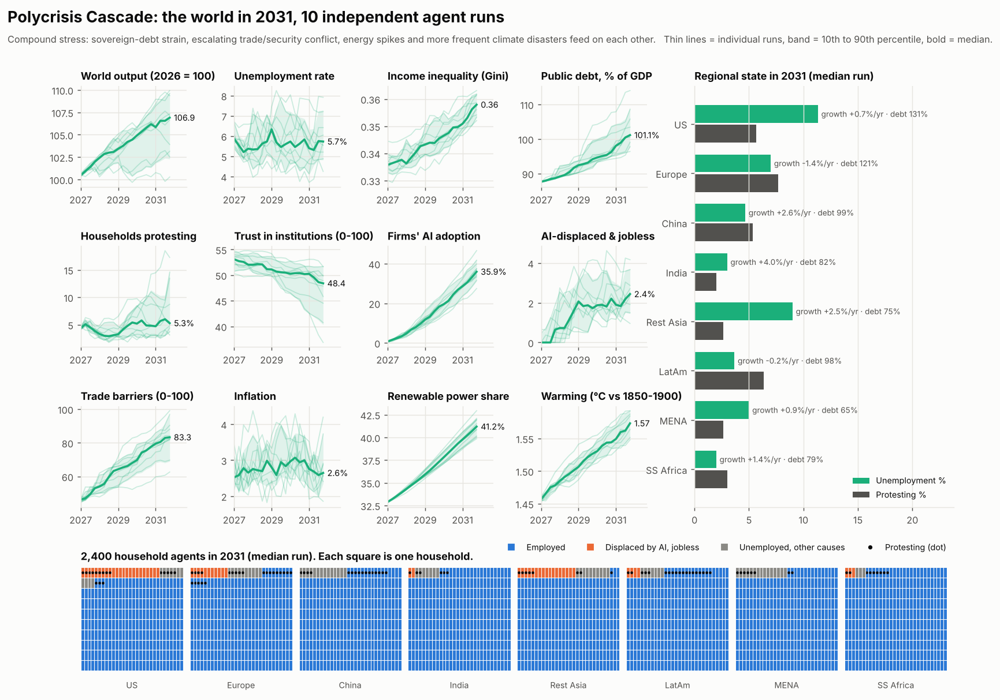

# World 2031: three agent-based simulations

**What was run:** 3 scenarios × 10 independent runs = 30 simulations. Each run creates a new population of agents from its own random seed: 8 government agents (with randomly drawn levels of populism, fiscal prudence, green ambition and social-policy reflex), 200 firm agents (deciding when to adopt AI) and 2,400 household agents (skill, job type, income, wealth, sentiment, protest). The model steps quarterly from Q4 2026 to Q4 2031.

**Starting constraints (late 2026, stylised):**
* Public debt of about 87% of GDP on a GDP-weighted basis (US about 122%).
* Warming of about 1.45 °C.
* Tariff and bloc fragmentation at 45/100.
* Early-stage AI adoption.
* Renewables at about a third of power.
* Climate exposure concentrated in the Global South.
* An ageing, polarised electorate.

> This is an illustrative model for exploring how pressures interact. It is not a forecast. Figures are medians across 10 runs, with ranges in brackets. Reproduce with `python3 model.py && python3 visualize.py`.

---

## Simulation 1: Fragmented Drift (muddle-through)

* **Growth is slow but positive.** World output grows about **2.3%/yr** [2.0 to 2.7]. India (+5.2%/yr) and Sub-Saharan Africa and Rest of Asia (about 2.8 to 2.9%) carry it. Europe (+0.6%) and the US (+1.0%) lag.
* **Debt keeps creeping up.** Weighted public debt rises from 87% to **about 95% of GDP**. The US ends near **130%** and Europe passes **100%**. In 7 of 10 runs at least one sovereign hits a debt-stress event, but none spirals.
* **AI arrives quietly.** About **32%** of firms adopt AI by 2031. Displacement stays modest: at most about 2.6% of households are jobless because of AI at the peak.
* **The labour market is stable.** Unemployment is about **5%** [4 to 6]. It is highest in the US (about 7%), where routine jobs and AI readiness overlap most.
* **Inequality rises slowly.** The Gini goes from 0.34 to **0.36**, because returns to capital and high-skill wages outpace routine wages.
* **Society is calm on the surface.** Protest settles at about **2 to 3%** of households and trust in institutions stays flat at about 51/100.
* **Climate is the slow loser.**
  * Renewables reach about **43%** of power and emissions fall about 9%.
  * Warming still reaches about **1.58 °C**.
  * About 6 climate disasters per run fall mostly on MENA, Sub-Saharan Africa and Latin America.
* **Trade barriers edge up** from 45 to about 53/100.
* **Takeaway:** the median world in 2031 works but is brittle. It has more debt, more barriers and more climate damage, and less fiscal room for the next shock.

## Simulation 2: AI Acceleration

* **Growth is the fastest of the three.** World output grows about **2.6%/yr** [2.3 to 3.1]. There are about 2.5 frontier capability jumps per run, and about **49%** of firms use AI by 2031.
* **The labour shock comes in a J-curve.**
  * Unemployment climbs to a median peak of **about 9.6%** around 2029–30 (worst run: 14%).
  * Up to about 7% of households are jobless because AI displaced them.
  * By 2031, reskilling and new demand bring unemployment back to about 6%.
* **The US is the epicentre.** It has the highest AI readiness and many routine jobs. US unemployment is about **12%** in 2031 and about **8.5% of households protest**, even as US growth rises to about 1.5%/yr.
* **Inequality rises most here.** The Gini goes from 0.34 to **0.38**, the steepest rise of the three. High-skill wage premiums and AI-driven returns on capital accrue to the top.
* **Policy response decides the outcome.** Governments that drew a strong "social" reflex and still had fiscal room funded reskilling and transfers, and their displaced workers were rehired faster. Low-room or low-social governments saw longer displacement spells.
* **Unrest peaks and then fades.** Median protest peaks at about 6% (above 8% in 2 of 10 runs), then fades as jobs return. Trust holds at about 53/100 because growth stays positive.
* **Climate gets a side benefit.** Renewables reach about **48%** of power, the most of any scenario, helped by AI-driven efficiency and cheaper capital. Emissions fall about 17%. Warming still reaches about 1.56 °C.
* **Debt is lowest of the three** (about 94% of GDP). Growth denominators help, and there are fewer debt crises (4 of 10 runs).
* **Takeaway:** the wealthiest world of the three, and the most unequal. The defining political fight of 2031 is who owns the gains from AI.

## Simulation 3: Polycrisis Cascade

* **Growth is weakest and least predictable.** World output grows about **1.4%/yr** [0.1 to 1.9]. The worst run is almost a lost half-decade.
* **Advanced economies stagnate.** The US (−0.3%/yr) and Europe (−0.9%/yr) are flat to shrinking. Asia and Africa keep growing, at a slower pace.
* **Debt crises cluster.** All 10 runs have at least one sovereign debt crisis, about **3.9 per run**, concentrated in the US (16 across runs) and Europe (9). Debt reaches about **101% of GDP**, with the US at about 145% and Europe at about 117%.
* **Trade and security split into blocs.**
  * Trade barriers jump from 45 to about **83/100**.
  * About 2.6 geopolitical or energy conflicts per run push energy prices to a median peak of **+73%** (worst case: double).
  * Inflation spikes to about 4 to 4.4% in bad quarters.
* **Climate disasters double up with fiscal stress.** There are about 8 disasters per run, mostly in Sub-Saharan Africa, India, Latin America and MENA. They hit governments that already have no fiscal room.
* **Social cohesion erodes.**
  * Protest peaks at a median of **7.6%** of households. It exceeds 8% in half the runs and reaches 18.5% in the worst.
  * US protest is about **13%** and Europe's about 7%.
  * Trust in institutions falls from 53 to about **48/100**, and to about 37 in the worst run.
* **The energy transition stalls.** Renewables reach only about **41%** of power. Austerity and conflict crowd out green investment.
* **AI still spreads** to about 36% of firms. Firms automate under cost pressure from energy and tariffs, not because demand is booming.
* **Takeaway:** a poorer, angrier, more fortified world. Shocks compound through debt and trust rather than through any single catastrophe.

---

## Cross-cutting findings (all 30 runs)

* **Debt is the binding constraint.** Governments with high debt have the least capacity to respond to AI displacement, disasters or unrest. That one variable separates the good runs from the bad ones within every scenario.
* **The Gini rises in every scenario** (0.34 → 0.36–0.38). How fast it rises depends on the scenario, but in this model none of the five-year paths reverses inequality.
* **Warming lands at about 1.56–1.58 °C in all three** scenarios. Five years is too short for policy to bend the temperature curve. Policy changes how the damage is distributed, not whether it happens.
* **AI is a double-edged accelerant.** It is the strongest source of upside for growth and renewables, and the largest short-run source of jobs risk and inequality, concentrated in high-readiness economies such as the US.
* **The Global South grows fastest and is the most exposed.** India, Sub-Saharan Africa and Rest of Asia lead growth in every scenario, but they absorb most of the climate disasters.
* **Unrest follows shocks to income and trust,** not the level of income. It is contagious within regions, so it appears in bursts. That makes the tails (the 90th-percentile runs) much worse than the medians.

## Method notes

* **Agents:**
  * *Governments* choose tariffs, transfers, reskilling, renewable investment and austerity in response to unrest, displacement, debt and their own preference draws.
  * *Firms* adopt AI with a probability set by AI capability, regional readiness, their own innovativeness and cost pressure. When they adopt, they lay off routine workers.
  * *Households* lose and find jobs, earn wages and capital income, update their sentiment, and protest. Protest spreads by regional contagion.
* **Shocks:**
  * Jumps in AI capability.
  * Geopolitical or energy conflict.
  * Regional climate disasters. Their likelihood rises with warming and with each region's exposure.
  * Sovereign debt crises. Their likelihood rises with debt and interest rates.
* **The scenarios differ only in a handful of parameters** (AI speed and displacement, tariff drift, conflict and energy volatility, disaster multiplier, debt stress, green push and the starting interest rate). See `SCENARIOS` in `model.py`.
* **The agents are computational, not LLM-based.** "Independent agents" means every run draws a fresh agent population and fresh preferences from its own seed (seeds 1000–1009, 2000–2009 and 3000–3009).
